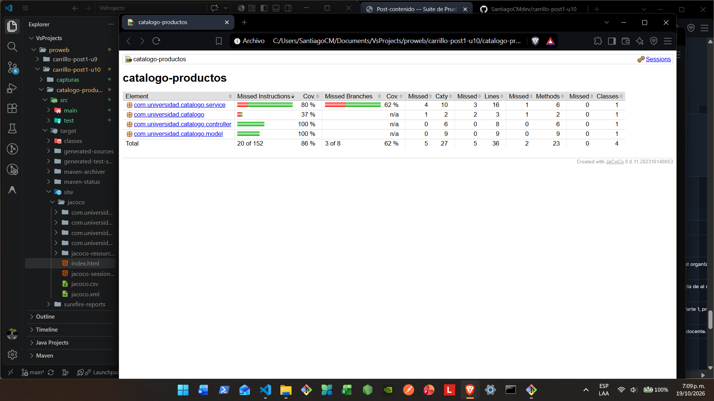
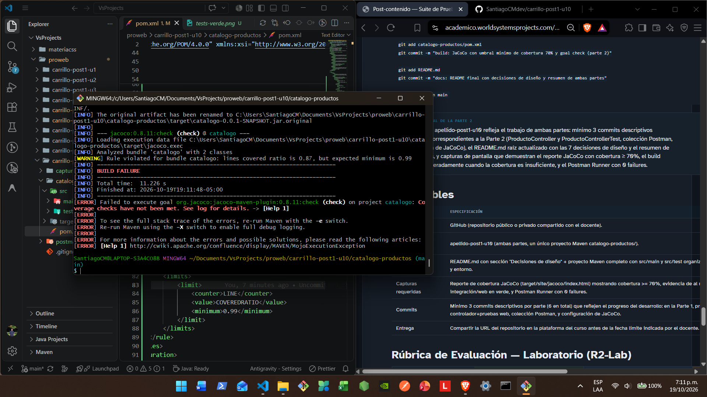
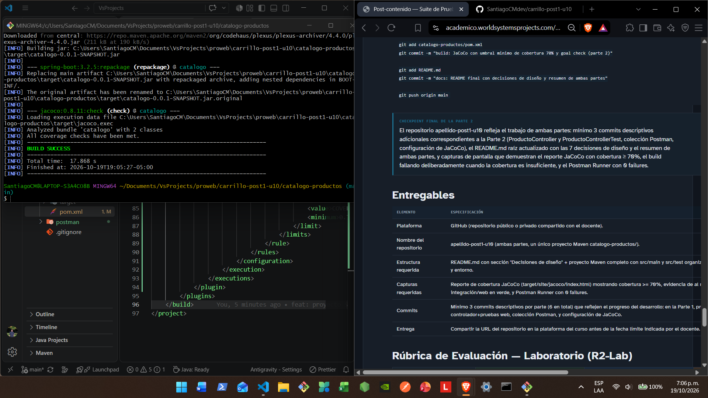
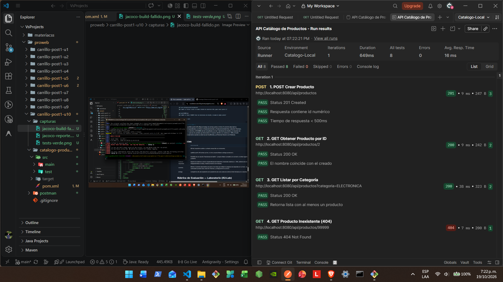

# Post-contenido - Unidad 10: Pruebas de Software en Aplicaciones Web

**Estudiante:** Santiago Eduardo Carrillo Molina  
**Código:** 02230132036  

## Descripción
Repositorio del laboratorio de la Unidad 10 de Programación Web - Séptimo Semestre. Contiene un único proyecto Maven Spring Boot (`catalogo-productos/`) con una suite de pruebas unitarias, de integración y de capa web sobre un catálogo de productos, más una colección Postman versionada y un umbral de cobertura verificado con JaCoCo.

## Parte 1 - Pruebas Unitarias con Mockito y de Integración con @DataJpaTest
`ProductoServiceTest` usa Mockito (`@Mock`, `@InjectMocks`) para probar la lógica de negocio en aislamiento, cubriendo el caso feliz y dos casos de error (precio inválido, producto no encontrado). `ProductoRepositoryTest` usa `@DataJpaTest` con H2 en memoria para probar las consultas del repositorio.

## Parte 2 - Pruebas Web con @WebMvcTest, Postman/Newman y JaCoCo
`ProductoControllerTest` usa `@WebMvcTest` con `MockMvc` para probar la capa web sin levantar el contexto completo. La colección Postman "API Catálogo de Productos" (`postman/ColeccionCatalogo.json`) ejecuta 4 requests con test scripts contra la aplicación en ejecución real, y puede correrse también con `newman run postman/ColeccionCatalogo.json --environment postman/env-local.json`. JaCoCo verifica una cobertura mínima del 70% de líneas sobre todo el módulo con `mvn verify`.

## Decisiones de diseño
1. H2 se usa también para ejecución local (no solo pruebas): el objetivo de la unidad es la escritura de pruebas, no el modelado de persistencia contra un motor externo como en la Unidad 8.
2. `buscarPorId` lanza `EntityNotFoundException` en vez de retornar `null`, para que el contrato del método sea explícito y verificable con `assertThrows`.
3. `ProductoRepositoryTest` usa `@DataJpaTest` en vez de `@SpringBootTest` para aislar la prueba a la capa de persistencia y mantener la suite rápida.
4. `ProductoControllerTest` usa `@WebMvcTest` en vez de `@SpringBootTest` con `TestRestTemplate`, para no duplicar cobertura con las pruebas de servicio y repositorio ya existentes.
5. La colección Postman se versiona como archivo `.json`, no como test JUnit, porque prueba el contrato HTTP completo como caja negra contra un proceso real, un nivel distinto al de `MockMvc`.
6. JaCoCo se configura al cierre de la Parte 2, no de la Parte 1, para medir la cobertura agregada de las tres capas y evitar que el umbral del 70% se cumpla artificialmente sobre una suite incompleta.
7. Este laboratorio NO incluye Selenium WebDriver: el dominio es una API REST pura sin vista Thymeleaf, y fabricar una vista solo para justificar Selenium contradiría la pirámide de pruebas. La colección Postman cumple el rol de prueba de extremo a extremo sobre la superficie real de la aplicación.

## Cómo compilar y ejecutar
1. Clonar el repositorio: `git clone https://github.com/TU_USUARIO/carrillo-post1-u10.git`
2. Ejecutar `mvn spring-boot:run` dentro de `catalogo-productos/`
3. Ejecutar la suite completa con verificación de cobertura: `mvn clean verify` (genera el reporte JaCoCo en `target/site/jacoco/index.html` y falla si la cobertura < 70%)
4. Con la aplicación en ejecución, correr la colección Postman: `newman run postman/ColeccionCatalogo.json --environment postman/env-local.json`

## Capturas de pantalla

